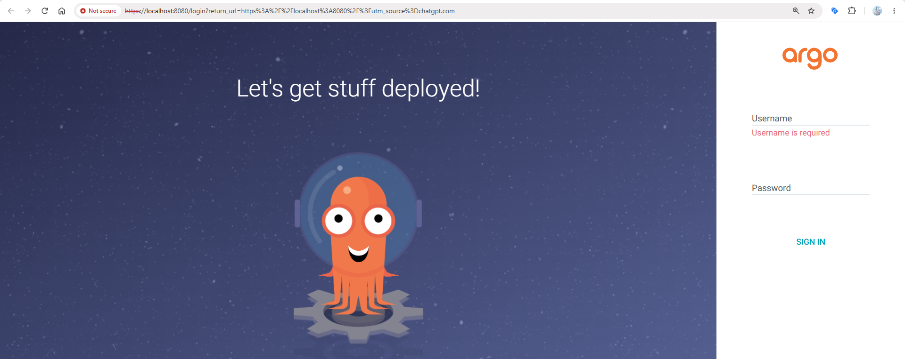
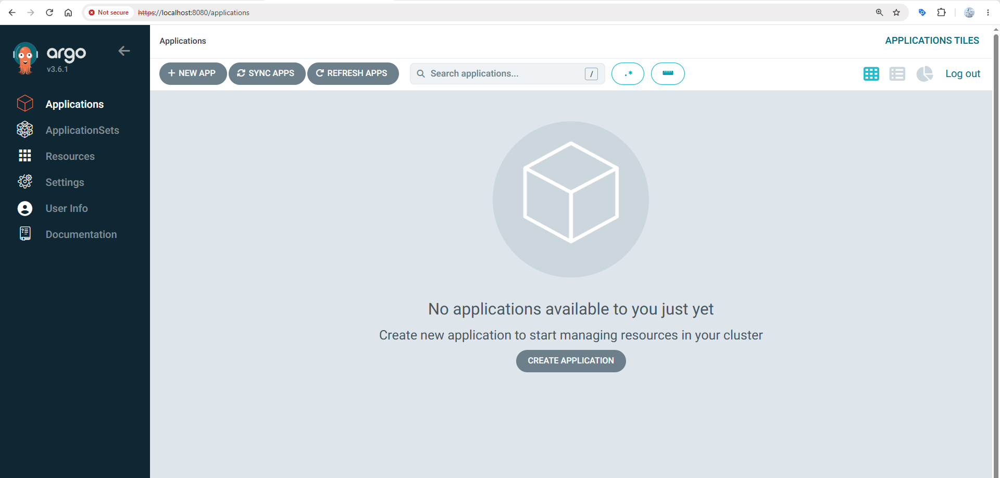

# Terraform Task — AWS EC2 & Docker

**Instructor requirements checklist · Verified lab evidence · 16 November 2026**

> **Assignment objective:** Provision an AWS EC2 instance using Terraform, secure access with an SSH key and Security Group, and install Docker and Docker Compose. The automated Docker installation (`remote-exec`) is the assignment's **bonus option**.

## Assignment status at a glance

| Area | Status | Evidence |
| --- | --- | --- |
| EC2 provisioning with Terraform | ✅ Completed | `terraform apply`: **6 added, 0 changed, 0 destroyed** |
| Instance name and Linux OS | ✅ Completed | `builder`, Ubuntu 24.04.5 LTS |
| EC2 size / access | ✅ Completed | `t3.small`, successful public-IP SSH session |
| SSH key management | ✅ Completed | AWS key pair, local private key, path output |
| Security Group | ✅ Completed | TCP `22` and `5001` restricted to `/32`; outbound open |
| Terraform outputs | ✅ Completed | Public IP, SSH key path, Security Group ID |
| Docker installation | ✅ Completed | Docker Client and Server **29.1.3** |
| Docker Compose installation | ✅ Completed | Docker Compose **2.40.3** |
| Docker runtime validation | ✅ Completed | `sudo docker ps` ran successfully |
| Automated installation — bonus | ✅ Completed | Successful `remote-exec` during `terraform apply` |

---

## Part 1 — Provision an EC2 instance with Terraform

### 1. Instance creation

- [x] Create an AWS EC2 instance using Terraform.
- [x] Set the EC2 Name tag to **`builder`**.
- [x] Select a Linux AMI that supports Docker (**Ubuntu 24.04.5 LTS**).
- [x] Select an instance type suitable for the lab (**`t3.small`**, 2 vCPU / 2 GiB RAM).
- [x] Deploy in **`us-east-1`** (Availability Zone `us-east-1a`).
- [x] Use a public subnet and verify SSH connectivity from the local machine.
- [x] Use an existing VPC, as allowed by the instructor's updated instruction.

**Infrastructure details from the successful run**

| Setting | Observed value |
| --- | --- |
| Terraform resource | `aws_instance.builder` |
| EC2 Name tag | `builder` |
| EC2 instance ID | `i-0ec698683c58982b8` |
| Instance type | `t3.small` |
| Operating system | Ubuntu 24.04.5 LTS |
| Region / AZ | `us-east-1` / `us-east-1a` |
| VPC | `vpc-0d859c220661ce168` |
| Subnet | `subnet-0be92e05246bd1d97` |
| Public IP (recorded) | `100.58.216.4` |

**Evidence:** `terraform apply` created `aws_instance.builder`, and SSH connected to `ubuntu@100.58.216.4`.

### 2. SSH key generation and management

- [x] Create an SSH public/private key pair for this assignment.
- [x] Keep the private key **locally**: `./ssh/builder-final-key`.
- [x] Register the public key with AWS via `aws_key_pair.nb-keypair`.
- [x] Configure EC2 to use the key pair named `ssh-key-pair`.
- [x] Output the **file path only**; do not output the private-key content.
- [x] Successfully log in using the generated key.

**Terraform key configuration (from submitted configuration):**

```hcl
resource "aws_key_pair" "nb-keypair" {
  key_name   = "ssh-key-pair"
  public_key = file("./ssh/builder-final-key.pub")
}
```

**Successful connection (Windows PowerShell):**

```powershell
ssh -i ./ssh/builder-final-key ubuntu@100.58.216.4
```

The session displayed `Welcome to Ubuntu 24.04.5 LTS`.

### 3. Security Group configuration

- [x] Allow inbound **SSH TCP 22**.
- [x] Allow inbound application **TCP 5001**.
- [x] Restrict both inbound rules to a trusted client IP (`/32`).
- [x] Allow all outbound traffic for package downloads and updates.

| Direction | Protocol | Port | Source / destination | Result |
| --- | --- | --- | --- | --- |
| Inbound | TCP | 22 | `84.229.81.109/32` | ✅ Configured |
| Inbound | TCP | 5001 | `84.229.81.109/32` | ✅ Configured |
| Outbound | All | All | `0.0.0.0/0` | ✅ Configured |

Security Group name: `allow_inbound`  
Security Group ID in the successful run: `sg-04bcd1a1166ccffe4`.

**Port 5001 validation:** Terraform successfully created the restricted inbound TCP 5001 rule (`sgr-0b92d1b31ea5b5ad6`) for `84.229.81.109/32`. This verifies rule provisioning, not application connectivity on that port.


### 4. Terraform outputs

- [x] Output the public IP.
- [x] Output the private SSH key's **location**.
- [x] Output the Security Group ID.

**Actual result:**

```text
Outputs:
ip = "100.58.216.4"
security_group = "sg-04bcd1a1166ccffe4"
ssh_location = "./ssh/builder-final-key"
```

---

## Part 2 — Docker installation and configuration

### Option 2 — Automated installation with Terraform `remote-exec` (bonus)

**Chosen implementation:** Docker and Docker Compose were installed automatically during instance creation over SSH. The manual-installation option was **not** used.

- [x] Use `remote-exec` during Terraform provisioning.
- [x] Update Ubuntu package metadata.
- [x] Install Docker Engine (`docker.io`).
- [x] Enable and start the Docker system service.
- [x] Install Docker Compose v2.
- [x] Verify Docker and Docker Compose after provisioning.
- [x] Complete Terraform apply successfully after the installation commands.

**Commands used in the Terraform bootstrap:**

```bash
sudo apt-get update -y
sudo apt-get install -y docker.io
sudo systemctl enable docker
sudo systemctl start docker
sudo systemctl is-active docker
sudo apt-get install -y docker-compose-v2
docker compose version
```

**Docker Compose evidence from Terraform output:**

```text
Docker Compose version 2.40.3+ds1-0ubuntu1~24.04.1
```

**Docker Engine — confirmed from Ubuntu session:**

```bash
sudo docker version
```

```text
Client:
 Version: 29.1.3
Server:
 Engine:
  Version: 29.1.3
```

**Container runtime — verified:**

```bash
sudo docker ps
```

```text
CONTAINER ID   IMAGE     COMMAND   CREATED   STATUS    PORTS     NAMES
```

---

## Validation and deliverables — instructor checklist

| Requirement | Status | Proof supplied |
| --- | --- | --- |
| Terraform plan | ✅ | `Plan: 6 to add, 0 to change, 0 to destroy.` |
| Terraform apply | ✅ | `Apply complete! Resources: 6 added, 0 changed, 0 destroyed.` |
| EC2 creation | ✅ | `aws_instance.builder: Creation complete` |
| SSH connectivity | ✅ | Successful Ubuntu login using local private key |
| Docker installation | ✅ | Docker Client/Server version output |
| Docker Engine validation | ✅ | `sudo docker ps` without errors |
| Docker Compose | ✅ | Compose version printed during provisioning |
| Security Group inbound restriction | ✅ | Ingress rules for TCP 22 and 5001, both `/32` |
| Security Group outbound access | ✅ | Egress `0.0.0.0/0`, all protocols |
| Automatic Docker installation (bonus) | ✅ | `remote-exec` output within successful Terraform apply |

**Recorded deployment result:**

```text
Plan: 6 to add, 0 to change, 0 to destroy.
...
aws_instance.builder: Provisioning with 'remote-exec'...
aws_instance.builder (remote-exec): Connected!
...
aws_instance.builder (remote-exec): Docker Compose version 2.40.3+ds1-0ubuntu1~24.04.1
...
aws_instance.builder: Creation complete after 1m20s [id=i-0ec698683c58982b8]

Apply complete! Resources: 6 added, 0 changed, 0 destroyed.
```

### Run the checks again

From Windows PowerShell (inside the Terraform project directory):

```powershell
terraform plan
terraform output ip
terraform output security_group
terraform output ssh_location
ssh -i ./ssh/builder-final-key ubuntu@100.58.216.4
```

From the Ubuntu SSH session:

```bash
sudo docker version
sudo docker ps
docker compose version
```

> Avoid including real credentials or the content of any private key in screenshots, console output, or commits.

---

## Optional extension — K3s Kubernetes and Argo CD (beyond the assignment)

### Extra accomplishments

- [x] Install K3s automatically during EC2 provisioning (`v1.37.2+k3s1`).
- [x] Run K3s as a Linux service (`active`).
- [x] Create the `argocd` Kubernetes namespace.
- [x] Deploy Argo CD using official manifests and `kubectl` (**without a Helm installation command**).
- [x] Confirm **7/7 Argo CD pods `1/1 Running`**.
- [x] Access the web dashboard over a secure SSH tunnel.
- [x] Log in to the Argo CD web dashboard (**v3.6.1**).
- [ ] Connect a Git repository and deploy the first GitOps Application (future lab).

**Argo CD installation:**

```bash
sudo k3s kubectl create namespace argocd
sudo k3s kubectl apply -n argocd --server-side --force-conflicts \
  -f https://raw.githubusercontent.com/argoproj/argo-cd/stable/manifests/install.yaml
```

**Later Kubernetes verification:**

```bash
sudo k3s kubectl get pods -n argocd
```

```text
argocd-application-controller-0                      1/1  Running
argocd-applicationset-controller-794bb95c9d-cf4bf    1/1  Running
argocd-dex-server-66cf64bfcf-fzntj                   1/1  Running
argocd-notifications-controller-5878c8d644-nb4mh     1/1  Running
argocd-redis-5869b7547-2tmf9                         1/1  Running
argocd-repo-server-7d55cc466b-hnr85                  1/1  Running
argocd-server-85b849c688-5nz2t                       1/1  Running
```

**Validation:** All seven Argo CD pods were `1/1 Running` when checked.

### Secure browser access

**Ubuntu terminal (kept open):**

```bash
sudo k3s kubectl port-forward svc/argocd-server -n argocd 8080:443 --address 127.0.0.1
```

**Windows PowerShell (second terminal, kept open):**

```powershell
ssh -i ./ssh/builder-final-key -L 8080:127.0.0.1:8080 ubuntu@100.58.216.4
```

**Browser:** `https://localhost:8080`. Login used the initial Kubernetes-generated admin credential, which is **not recorded** in this README.

### Original screenshots from the lab

**1. Argo CD login screen**



**2. Argo CD Applications dashboard after successful login**



---
